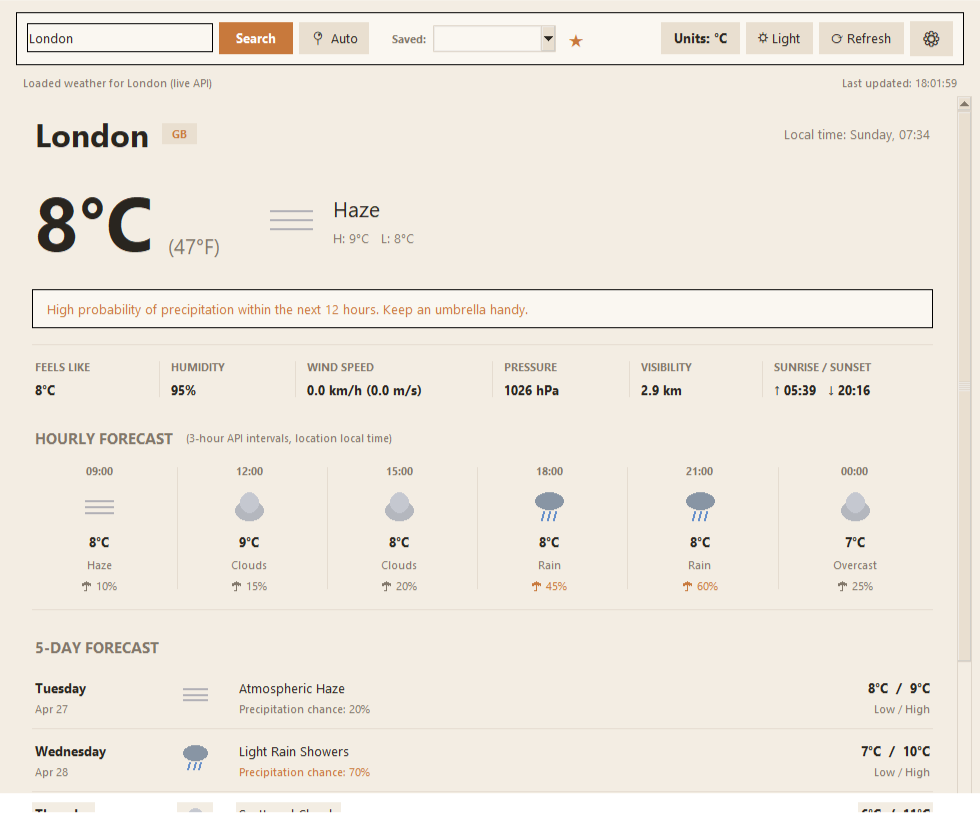
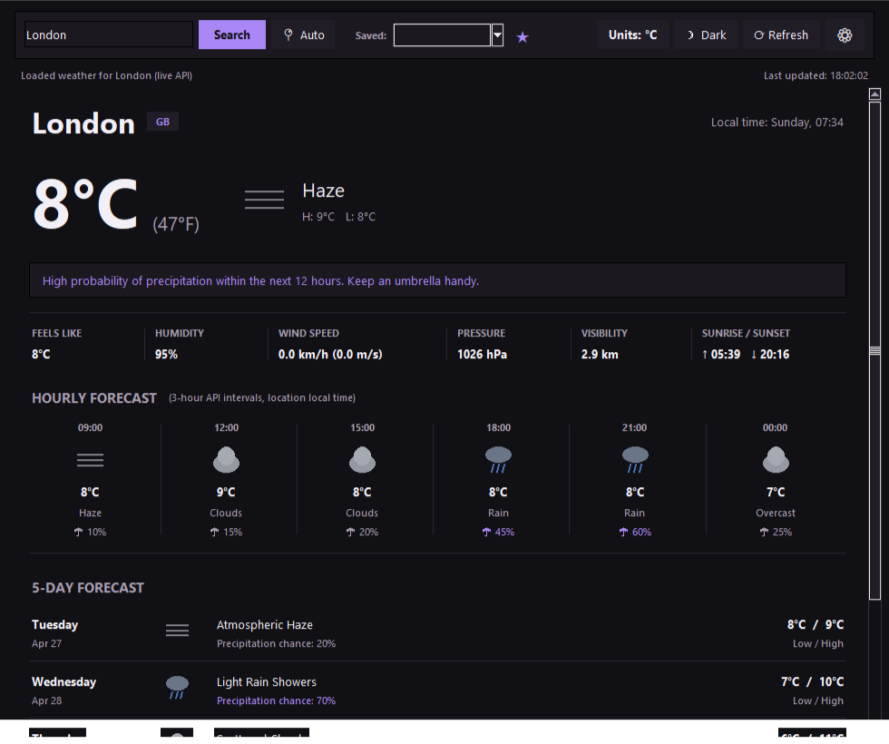
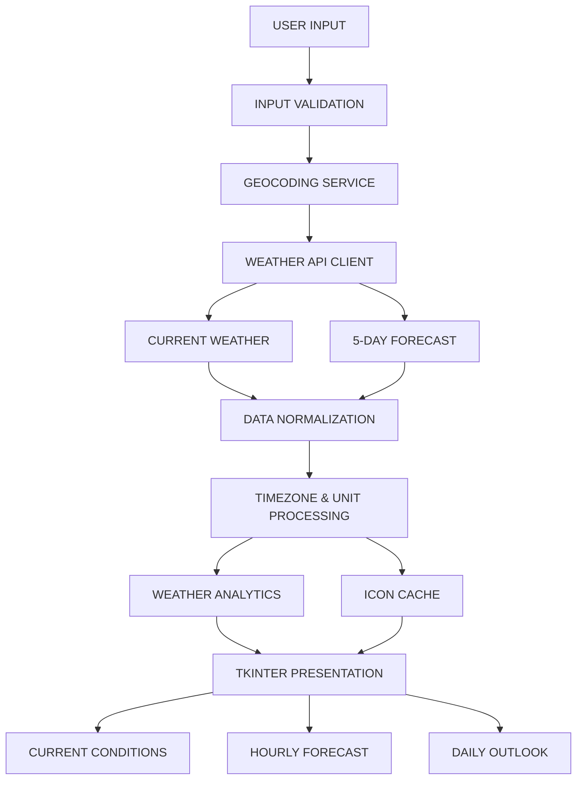

<div align="center">

# ⛅ WEATHER & FORECAST

### REAL-TIME WEATHER · SMART FORECASTING · DESKTOP EXPERIENCE

**Understand the Weather. Plan Your Day.**

<br/>


<br/>

[](https://www.python.org/)
[](https://docs.python.org/3/library/tkinter.html)
[](https://openweathermap.org/api)
[](tests/)
[](LICENSE)

<br/>


</div>

---

<div align="center">

## ◈ PROJECT OVERVIEW

</div>

**Weather & Forecast** (`ArnavSharma_Task4`) is an editorial, minimalist desktop weather and lifestyle application developed using Python, Tkinter, ttk, and Pillow.

The application integrates directly with the OpenWeatherMap REST API to retrieve real-time meteorological information and provide detailed hourly and five-day forecasts.

It combines asynchronous networking, location-aware timezone calculations, weather icon caching, analytical insights, and persistent location favourites within a modern desktop interface.

### Core Philosophy

| Principle | Implementation |
|:---|:---|
| Real-Time Intelligence | Live OpenWeatherMap API integration |
| Performance | Background networking and thread-safe UI callbacks |
| Accuracy | Location-specific timezone calculations |
| Personalization | Favourite locations and unit preferences |
| Accessibility | Light and Dark visual themes |
| Reliability | Caching, error handling and offline icon fallback |

---

## ◈ 01 — PRIMARY OBJECTIVES

The application is designed to:

1. Search weather using city names, city-country combinations, or postal/ZIP codes.
2. Display current atmospheric conditions and temperature.
3. Provide both Celsius and Fahrenheit measurements.
4. Display the next six hourly forecast intervals.
5. Provide a five-day weather outlook.
6. Toggle temperature units without unnecessary API requests.
7. Save and revisit favourite cities.
8. Support optional IP-based location detection with explicit consent.
9. Handle network failures, API errors, timeouts and invalid queries gracefully.

---

## ◈ 02 — APPLICATION SCREENSHOTS

<div align="center">

### LIGHT MODE — WARM BEIGE & BURNT ORANGE



<sub>Warm beige canvas · Burnt orange accents · Minimalist editorial interface</sub>

<br/><br/>

### DARK MODE — BLACK & SOFT VIOLET



<sub>Near-black canvas · Soft violet accents · Refined dark interface</sub>

</div>

---

## ◈ 03 — VISUAL IDENTITY & THEMES

The application follows an editorial design philosophy, rejecting cluttered multi-column dashboard grids, excessive neon borders, and unnecessary faux-glass effects.

It uses open canvas layouts, generous whitespace, subtle separators, and typography-led hierarchy.

### Theme Color System

| Color Role | Light Theme | Dark Theme |
|:---|:---|:---|
| Main Background | `#F3EDE3` | `#111014` |
| Surface | `#FAF7F1` | `#1B1820` |
| Secondary Surface | `#E9DFD0` | `#211D27` |
| Primary Accent | `#C8793C` | `#A987F5` |
| Primary Text | `#29251F` | `#F2EFF7` |
| Secondary Text | `#81776A` | `#A69BAF` |
| Borders | `#DED5C9` | `#37303F` |

### Design Principles

- Open-canvas composition.
- Hero temperature typography.
- Floating horizontal hourly forecast.
- Minimalist weather metrics.
- Subtle separators and visual hierarchy.
- Consistent typography and spacing.
- Responsive visual theme switching.

---

## ◈ 04 — FEATURE CHECKLIST

### Beginner Tier Features

- [x] **Location Input:** Supports city names (`Paris`), city and country (`London, UK`), and postal codes (`110001, IN`).
- [x] **Input Validation:** Trims whitespace, rejects blank queries and prevents invalid characters.
- [x] **Weather API Integration:** Official OpenWeatherMap Current Weather and 5-Day Forecast endpoints.
- [x] **Current Weather Display:**
  - Location name and ISO country badge.
  - Temperature in Celsius and Fahrenheit.
  - Humidity percentage.
  - Weather condition and detailed description.
  - Wind speed in multiple units.
  - Atmospheric pressure.
  - Feels-like temperature.
  - Visibility.
  - Sunrise and sunset times.
- [x] **Accurate Conversion Formula:**

\[
^\circ F = (^\circ C \times 9/5)+32
\]

- [x] **Error Handling:** Handles 404, 401, 429, timeouts and connection failures.

### Advanced Tier Features

- [x] Complete Tkinter/ttk desktop GUI.
- [x] Non-blocking background networking.
- [x] Weather icon CDN integration.
- [x] Pillow-based image resizing and caching.
- [x] Six-interval hourly forecast.
- [x] Five-day forecast.
- [x] Dynamic Celsius/Fahrenheit unit switching.
- [x] In-app dismissible error banners.
- [x] Thread-safe UI callbacks.

### Bonus Features

- [x] **Automatic Location Detection:** Optional IP geolocation through ipinfo.io with ipapi.co fallback.
- [x] **Saved Favourites:** Persistent JSON storage and quick selection.
- [x] **Weather Refresh:** Manual refresh with three-second debounce.
- [x] **Analytical Insights:** Rain, wind, humidity and temperature warnings.
- [x] **Offline Icon Fallback:** Procedural weather graphics when external icon requests fail.
- [x] **Timezone Awareness:** Location-specific local timestamps.

---

## ◈ 05 — TECHNOLOGY STACK

<div align="center">


</div>

| Component | Technology | Purpose |
|:---|:---|:---|
| Programming Language | Python 3.10+ | Core application |
| GUI Framework | Tkinter / ttk | Desktop interface |
| HTTP Client | requests | REST API communication |
| Image Processing | Pillow | Weather icon processing |
| Weather Provider | OpenWeatherMap | Live meteorological data |
| Geolocation | ipinfo.io / ipapi.co | IP-based location |
| Configuration | python-dotenv | Environment variables |
| Serialization | JSON | Favourites and configuration |
| Logging | Python logging | Application diagnostics |
| Testing | pytest | Automated testing |
| Mocking | unittest.mock | API and integration testing |
| Packaging | PyInstaller | Windows executable |

---

## ◈ 06 — OPENWEATHERMAP API INTEGRATION

The application directly communicates with OpenWeatherMap's REST API.

### Obtaining an API Key

1. Visit [OpenWeatherMap](https://openweathermap.org/api).
2. Create a free account.
3. Navigate to the API Keys section.
4. Generate and copy your API key.
5. Add the key to your `.env` configuration.

### Endpoints Utilized

| Endpoint | Purpose |
|:---|:---|
| `/data/2.5/weather` | Current weather |
| `/data/2.5/forecast` | Five-day forecast |
| `/geo/1.0/direct` | City geocoding |
| `/geo/1.0/zip` | Postal code geocoding |
| `/img/wn/{icon}@2x.png` | Weather condition icons |

### Free Tier Endpoint Notice

The OpenWeatherMap free tier provides the 5-Day / 3-Hour Forecast API, which delivers 40 forecast entries spaced three hours apart.

The application processes these entries by grouping them according to the destination's local calendar day.

This enables calculation of:

- Daily minimum and maximum temperatures.
- Dominant midday weather conditions.
- Peak precipitation probability.
- Location-aware five-day weather summaries.

### Verified Live API Response Structure

Below is an authentic OpenWeatherMap JSON response for London, United Kingdom (`GET /data/2.5/weather?q=London&appid=...`):

```json
{
  "coord": {
    "lon": -0.1257,
    "lat": 51.5085
  },
  "weather": [
    {
      "id": 721,
      "main": "Haze",
      "description": "haze",
      "icon": "50d"
    }
  ],
  "base": "stations",
  "main": {
    "temp": 8.26,
    "feels_like": 8.26,
    "temp_min": 7.53,
    "temp_max": 8.89,
    "pressure": 1026,
    "humidity": 95,
    "sea_level": 1026,
    "grnd_level": 1021
  },
  "visibility": 2900,
  "wind": {
    "speed": 0,
    "deg": 0
  },
  "clouds": {
    "all": 100
  },
  "dt": 1745735677,
  "sys": {
    "type": 1,
    "id": 1414,
    "country": "GB",
    "sunrise": 1745728782,
    "sunset": 1745781377
  },
  "timezone": 3600,
  "id": 2643743,
  "name": "London",
  "cod": 200
}
```

#### Field-by-Field Normalization Mapping

| API Field | Type | Sample Value | Application Display | Normalization / Conversion Logic |
|:---|:---|:---|:---|:---|
| `name` | String | `"London"` | `London` | Direct location title |
| `sys.country` | String | `"GB"` | `GB` | ISO country badge pill |
| `main.temp` | Float | `8.26` °C | `8°C` *(or `47°F`)* | Hero temperature numeral; converted via $^\circ\text{F} = (^\circ\text{C} \times 9/5) + 32$ |
| `main.feels_like`| Float | `8.26` °C | `8°C` *(or `47°F`)* | Rendered in the floating metrics strip |
| `main.temp_min` / `max`| Float | `7.53` / `8.89` | `H: 9°C   L: 8°C` | High and Low day envelope |
| `main.humidity`| Integer | `95` | `95%` | Humidity display + analytical moisture alert |
| `main.pressure`| Integer | `1026` | `1026 hPa` | Barometric atmospheric pressure |
| `visibility` | Integer | `2900` | `2.9 km` *(or `1.8 mi`)* | Scaled to kilometers (metric) or miles (imperial) |
| `wind.speed` | Float | `0` | `0.0 km/h (0.0 m/s)` | Formatted based on unit preference |
| `weather[0].main` | String | `"Haze"` | `Haze` | Weather condition summary |
| `weather[0].icon` | String | `"50d"` | Atmospheric mist icon | Cached via Pillow to `cache/icons/50d.png` |
| `timezone` | Integer | `3600` | BST / UTC+1 | Local time shift in seconds (ensures accurate clock time) |
| `sys.sunrise` / `sunset` | Timestamp | `1745728782` / `1745781377` | `↑ 05:59   ↓ 20:36` | Localized sunrise and sunset times for the searched city |

---

## ◈ 07 — 3D SYSTEM ARCHITECTURE

<div align="center">

### Modular Weather Processing Pipeline

</div>



### Architectural Layers

| Layer | Responsibility |
|:---|:---|
| Presentation | Tkinter views, navigation and themes |
| Service | API communication and geolocation |
| Processing | Weather normalization and forecast calculations |
| Caching | Memory cache and persistent icon storage |
| Utility | Validation, conversions and timezone helpers |
| Persistence | Favourites and local configuration |
| Testing | API, forecast, validation and GUI tests |

---

## ◈ 08 — PROJECT STRUCTURE

```text
ArnavSharma_Task4/
│
├── main.py
├── config.py
├── requirements.txt
├── README.md
├── .env.example
├── .gitignore
├── weather_app.spec
│
├── services/
│   ├── __init__.py
│   ├── weather_api.py
│   ├── geocoding.py
│   ├── location_service.py
│   └── cache_service.py
│
├── modules/
│   ├── __init__.py
│   ├── main_window.py
│   ├── current_weather.py
│   ├── hourly_forecast.py
│   ├── daily_forecast.py
│   ├── favourites.py
│   └── settings.py
│
├── themes/
│   ├── __init__.py
│   ├── theme_manager.py
│   ├── light.py
│   └── dark.py
│
├── utils/
│   ├── __init__.py
│   ├── validators.py
│   ├── weather_helpers.py
│   ├── logger.py
│   └── helpers.py
│
├── assets/
│   └── screenshots/
│       ├── light_mode.png
│       └── dark_mode.png
│
├── cache/
│   ├── .gitkeep
│   └── icons/
│
└── tests/
    ├── __init__.py
    ├── test_weather_api.py
    ├── test_forecast.py
    ├── test_validation.py
    ├── test_units.py
    └── test_gui.py
```

---

## ◈ 09 — INSTALLATION & SETUP

### Prerequisites

- Python 3.10, 3.11, 3.12 or 3.13.
- Internet connection for live API queries.
- OpenWeatherMap API key.
- pip package manager.

### Step 1 — Clone Repository

```bash
git clone https://github.com/ArnavSharma/ArnavSharma_Task4.git

cd ArnavSharma_Task4
```

### Step 2 — Create Virtual Environment

**Windows PowerShell**

```powershell
python -m venv venv

.\venv\Scripts\Activate.ps1
```

**Windows Command Prompt**

```cmd
python -m venv venv

.\venv\Scripts\activate.bat
```

**Linux / macOS**

```bash
python3 -m venv venv

source venv/bin/activate
```

### Step 3 — Install Dependencies

```bash
pip install -r requirements.txt
```

### Step 4 — Configure Environment Variables

Copy `.env.example` to `.env`.

**Windows PowerShell**

```powershell
Copy-Item .env.example .env
```

Edit `.env` and add your API credentials:

```ini
OPENWEATHER_API_KEY=your_actual_api_key_here

DEFAULT_LOCATION=London
DEFAULT_UNITS=celsius
DEFAULT_THEME=light
API_TIMEOUT_SECONDS=10
```

You can also enter or update your API key directly through the application's Settings interface.

**Security:** Never commit `.env` or expose your API credentials publicly.

---

## ◈ 10 — RUNNING THE APPLICATION

Launch the desktop application:

```bash
python main.py
```

The application initializes its configuration, themes, services and graphical interface.

After launch, enter a city name or postal code to retrieve live weather information.

---

## ◈ 11 — CORE FUNCTIONAL WALKTHROUGH

### Current Conditions

Displays:

- City and country information.
- Local clock time.
- Hero temperature.
- High and low temperature range.
- Feels-like temperature.
- Humidity.
- Wind speed.
- Atmospheric pressure.
- Visibility.
- Sunrise and sunset times.

### Hourly Forecast

Displays the next six forecast intervals in a horizontal layout.

Each interval includes:

- Local timestamp.
- Weather icon.
- Temperature.
- Weather condition.
- Precipitation probability.

### Five-Day Outlook

The application groups three-hour forecast entries according to the destination's local calendar day.

It calculates:

- Daily minimum temperature.
- Daily maximum temperature.
- Dominant midday condition.
- Peak precipitation risk.

### Dynamic Unit Toggling

Switch between Celsius and Fahrenheit through the top navigation bar.

All displayed temperature metrics are recalculated in memory without unnecessary API requests.

### Saved Favourites

- Click the star button to save a location.
- Switch between saved cities using the dropdown.
- Favourites persist across restarts.
- Data is stored in `cache/favourites.json`.

### IP Geolocation

Click the Auto Location button to retrieve an approximate location using IP geolocation.

The application displays an informational privacy dialog before requesting location information.

### Analytical Weather Insights

The application generates contextual recommendations based on live weather data.

| Condition | Insight |
|:---|:---|
| Rain risk | Umbrella recommendation |
| Wind above 10 m/s | Strong wind advisory |
| Humidity above 85% | Humidity discomfort warning |
| Temperature below 0°C | Freezing and ice advisory |

---

## ◈ 12 — CACHING & PERFORMANCE ARCHITECTURE

The application uses several performance optimizations.

### 1. Memory Caching

Recent weather queries are cached in memory for ten minutes.

Repeated searches for the same location within the cache lifetime return cached results without additional network requests.

### 2. Refresh Debouncing

Manual refresh forces a cache bypass.

A three-second debounce prevents accidental repeated refresh requests.

### 3. Pillow Icon Pipeline

Downloaded weather icons are saved locally:

```text
cache/
└── icons/
    ├── 01d.png
    ├── 02d.png
    └── ...
```

Subsequent requests use locally cached icons and high-quality Lanczos resizing.

### 4. Procedural Offline Fallback

When offline or when CDN requests fail, the application uses a built-in Pillow-based procedural renderer to generate symbolic weather graphics.

### 5. Asynchronous Networking

HTTP operations run in background threads.

Thread-safe callbacks dispatch the results to the Tkinter interface, preventing blocking network requests from freezing the GUI.

---

## ◈ 13 — ERROR HANDLING & RESILIENCE

The application handles API and network anomalies through in-app notification banners.

| Error | Cause | Application Response |
|:---|:---|:---|
| 404 Not Found | Invalid location | Location validation message |
| 401 Unauthorized | Invalid API key | API configuration guidance |
| 429 Rate Limit | Excessive requests | Rate-limit notification |
| Timeout | Slow network | Connection timeout message |
| Connection Error | Network unavailable | Connectivity notification |
| Validation Error | Invalid user input | Input guidance |

All supported error conditions are handled without intentionally terminating the application.

---

## ◈ 14 — PRIVACY & SECURITY

The application incorporates several privacy-conscious design decisions.

- **Zero Hardcoded Secrets:** API credentials are loaded through environment variables or `.env`.
- **Git Security:** `.env`, `.env.local` and user cache files are excluded through `.gitignore`.
- **Redacted Logging:** Sensitive API key parameters are filtered before logs are written.
- **IP Geolocation Transparency:** Location detection is optional and requires explicit user action.
- **Local Favourites:** Saved locations are maintained in local JSON storage.
- **Controlled API Requests:** Network requests use configured timeout handling.

---

## ◈ 15 — AUTOMATED TESTING SUITE

<div align="center">


### Comprehensive Testing Coverage

</div>

The repository includes a 35-test automated testing suite implemented using `pytest` and `unittest.mock`.

### Run Tests

```bash
python -m pytest -v
```

### Test Coverage

| Test File | Testing Focus |
|:---|:---|
| `test_units.py` | Celsius/Fahrenheit conversion, wind, pressure and visibility |
| `test_validation.py` | City names, country codes and postal codes |
| `test_forecast.py` | Hourly extraction, timezone and five-day grouping |
| `test_weather_api.py` | API responses, errors, timeouts and caching |
| `test_gui.py` | Theme switching, listeners and favourites |

### Testing Highlights

- Temperature conversion boundaries.
- Decimal precision.
- International location validation.
- Timezone offset calculations.
- Five-day forecast grouping.
- Missing API field handling.
- HTTP 401, 404 and 429 responses.
- Network timeout and connection failures.
- Cache hit and bypass behaviour.
- Theme manager and favourites persistence.

---

## ◈ 16 — WINDOWS DEPLOYMENT & EXECUTABLE PACKAGING

The application supports standalone Windows executable packaging through PyInstaller.

### Step 1 — Install PyInstaller

```bash
pip install pyinstaller
```

### Step 2 — Build Using Specification File

```bash
pyinstaller weather_app.spec
```

### Step 3 — Locate Executable

```text
dist/
└── WeatherForecast.exe
```

The packaged application runs in standalone windowed mode without opening an additional console window.

---

## ◈ 17 — TROUBLESHOOTING GUIDE

<details>
<summary><b>▶ Invalid OpenWeatherMap API Key</b></summary>

- Verify that your API key is correctly entered in Settings or `.env`.
- Newly generated keys may require 10–30 minutes to activate.
- Ensure the correct API key is being used.

</details>

<details>
<summary><b>▶ Location Was Not Found</b></summary>

Add a two-letter country code for better location precision.

Examples:

```text
Cambridge, GB
Cambridge, US
90210, US
SW1A 1AA, GB
```

</details>

<details>
<summary><b>▶ Missing Weather Icons</b></summary>

The application automatically switches to procedural symbolic weather graphics when offline or when external CDN requests are unavailable.

</details>

---

## ◈ 18 — FUTURE ROADMAP

| Enhancement | Status |
|:---|:---:|
| Interactive Precipitation Radar | Planned |
| Multi-City Comparative Split View | Planned |
| Air Quality Index Integration | Planned |
| Severe Weather Desktop Notifications | Planned |

---

## ◈ 19 — AUTHOR & LICENSE

<div align="center">

<h2>ARNAV SHARMA</h2>

**Computer Science & Artificial Intelligence**

<br/>

[](https://github.com/ArnavSharma-IND)

[](https://www.linkedin.com/in/arnav-sharma-dev/)

<br/>

**Project:** Weather & Forecast

**Repository:** `ArnavSharma_Task4`

**Internship:** Oasis Infobyte Python Programming

**Language:** Python 3

**API Provider:** OpenWeatherMap

**License:** MIT License

<br/>

*Built with precision. Designed around the weather.*

### ◈ END OF DOCUMENTATION

</div>
